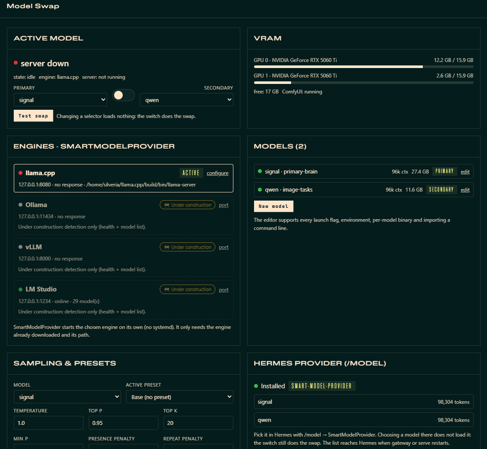

# Smart-Model-Swap 🐉

Run a **big** and a **small** local LLM on one rig and let the agent switch between them by task:

- the small one for quick or voice chat, and to free VRAM for GPU jobs such as ComfyUI;
- the big one for deep work.

Swaps run in the background without cutting the agent's reply. The plugin checks per-GPU VRAM before loading a model and brings the big model back on its own when idle.



**Requirements**
- Linux or WSL2 with an NVIDIA GPU and `nvidia-smi`.
- A built [llama.cpp](https://github.com/ggml-org/llama.cpp) `llama-server`.
- GGUF models on disk.
- Optional: a systemd user session, so the engine runs in its own transient scope and survives gateway restarts.

**SmartModelProvider (SMP)** is the engine manager inside the plugin. It launches
the inference engine you picked and manages the models on it — no systemd unit.
The engine only has to be installed already; SMP needs its path and endpoint.
Each model's launch line is editable from the UI, in the style of
[Llamacpp-Model-Launcher](https://github.com/Kaspur2012/Llamacpp-Model-Launcher).

Built for the [Hermes Agent Plugin Hackathon](https://nousresearch.com/blog/hermes-agent-plugin-hackathon) (Nov 2026).

## Why

Big brain = slow for small tasks, and it eats VRAM you need for image generation.
Smart-Model-Swap cuts the swap from a 13-minute manual ritual to one tool call:

1. `sms_plan` — "ComfyUI needs ~6 GiB free" → recommends the right model.
2. `sms_swap model=qwen dry_run=true` → validates files, VRAM fit, runner liveness.
3. `sms_swap model=qwen` → grace countdown (10 s) so the agent finishes its turn, then a
   detached runner stops the model, settles VRAM, loads the target, health-checks.
4. `sms_restore` → brain back (SMP relaunches the primary with its own command line).

When the Hermes gateway starts and nothing is serving, SMP loads the primary model by
itself (`autostart_primary`).

Zero dependencies beyond the Python standard library.

## Tools

| Tool | What it does |
|---|---|
| `sms_status` | Swap state machine, current model, per-GPU VRAM, ComfyUI status, last result |
| `sms_plan` | VRAM-budget recommendation across the model registry |
| `sms_swap` | Background hot-swap with grace + preflight (`dry_run` supported) |
| `sms_restore` | Restore the primary model (SMP relaunches it) |

Slash: `/swap qwen [dry]`, `/swap restore [dry]`, `/swap plan 6`, `/swap status`.
CLI: `hermes sms status|plan|swap <m> [--dry-run] [--wait] [--force]|restore [--dry-run] [--wait] [--force]|wait [--target m]|start|stop|cmd <m>|provider …`.

- `--wait` blocks until the runner finishes and exits 0 only if the requested model is serving. This lets
  scripts (and the agent's terminal) continue on the new model. `hermes sms wait` does the same for a
  swap that is already running.
- A swap or restore to the model that is **already serving** is a no-op (`"skipped"`). Use `--force` to
  reload it anyway, e.g. after editing its flags.
- **Release gate.** A model is loaded only when every GPU it uses has room for its share.
  - The share is measured on each load and kept in `cache/smart-model-swap/vram_profile.json`. Until a
    model has been measured, it is estimated from `min_free_vram_gb` and `-ts`/`--device`/`-sm`.
  - The preflight refuses a swap or restore while other heavy GPU processes (ComfyUI, …) hold that VRAM,
    without cutting the current model.
  - After stopping the current model, the runner waits up to `release_wait_s` (default 120). If the VRAM
    is not released, it reloads the previous model (or the smallest one that fits) instead of the target.
  - `hermes sms check [model] [--wait N]` runs the same gate from scripts. `sms_status` lists
    `gpu_holders`.
- **Bundled skill.** The agent's big-vs-small routing rules ship with the plugin as
  `skill_view("smart-model-swap:smart-model-routing")` (`skills/smart-model-routing/`). It includes
  `templates/gpu_job.sh`, which frees VRAM, runs a job and always leaves a model serving (the small one by default). Plugin skills are not listed in the
  system prompt; the tool descriptions and hints point the agent to it.

## Engines

| Engine | State | What SMP does |
|---|---|---|
| llama.cpp (`llama-server`) | **managed** | Builds the argv, spawns it, health / drain / identity checks, stops it by signal |
| Ollama | 🚧 under construction | Detection only: health + model list on its endpoint |
| vLLM | 🚧 under construction | Detection only |
| LM Studio | 🚧 under construction | Detection only |

Engines are configured in the **Engines** card of both UIs (or in `models.json` →
`engines`). For llama.cpp, set the binary (a file, or the folder that holds
`llama-server`), host, port, environment, and the common args every model gets.
SMP adds `-m <gguf> --host <host> --port <port>` itself, so these never belong in a
model's args. Only a managed engine can be the active one.

## Model registry (`models.json`, v2)

```json
{ "version": 2,
  "engines": { "llamacpp": { "bin": "…/llama-server", "host": "127.0.0.1", "port": 8080,
                             "env": {"CUDA_VISIBLE_DEVICES": "0,1"}, "common_args": ["-ngl", "99", "…"] },
               "ollama": {"host": "127.0.0.1", "port": 11434}, "…": {} },
  "active_engine": "llamacpp",
  "models": [ { "name": "qwen", "engine": "llamacpp", "gguf": "…", "mmproj": "…",
                "args": ["-c", "65536", "--temp", "1.0", "…"], "env": {}, "bin": "",
                "min_free_vram_gb": 7.0, "load_timeout_s": 300 } ] }
```

The launch line is `bin -m gguf --host H --port P <common_args> <model args>`, with
the active preset applied on top. Use `hermes sms cmd <model>` to print it. A per-model
`bin` overrides the engine's binary (for example a CUDA build vs a Vulkan build), and a
per-model `env` adds variables. Point `models_file` at your own JSON to override.

**Migration from 0.2:** a v1 file is migrated on first load and the original is kept as
`models.json.bak-v1`. The migration does the following:
- `start_mode` is removed.
- `common_args` and `--host`/`--port` move to `engines.llamacpp`.
- `llama_bin` and `base_url` are read once from the old settings.
- The old servers in `ui.json` become engines.
- `Environment=` lines from the old `llama-server.service` become the engine env.

**Model names.**
- Allowed: up to 64 characters of letters (any case, accents included), digits and `. _ - + ( ) [ ] ,`.
  The first character must be a letter or a digit.
- Not allowed:
  - spaces, because `/swap` and the CLI split on them;
  - `/` and `\`, because the name becomes a log file name;
  - `:`, because Hermes uses it to separate provider and model.
- Names are unique **case-insensitively**, and lookups ignore case: `hermes sms swap qwen` finds `Qwen3.5-9B`.
  Shells need quotes around names with `( ) [ ]`.

### Launch-parameter editor

Click **edit** on a model (dashboard tab or desktop pane) to open the editor:
- **Fields:** name, engine, GGUF, mmproj, per-model binary, environment variables, VRAM need and load timeout.
- **Parameters:** one row per flag (value, or a switch) that you can reorder or remove, plus a manual "add".
- **Catalog:** a searchable catalog of parameters with descriptions. It is checked against your build's
  `llama-server --help`, so removed flags are marked and flags your build has but the database lacks are listed under
  "Detectado en tu build".
- **Import a command line:** paste `llama-server -m … --temp 0.7 …` to fill the editor.
- **Validate:** the exact argv is parse-checked with `--version`, so nothing loads. You also get the final command and
  suggested fixes for obsolete or duplicate flags.
- **Model actions:** save, reset, duplicate and delete.

Changes apply the next time the model is loaded.

### Sampling parameters and presets

The quick editor changes six sampling parameters: temperature, top-p, top-k, min-p,
presence penalty and repeat penalty.
- **Save** writes them into the model's `args`.
- **Save as preset** stores them under a name in the model's `presets` and marks it as `active_preset`.

The active preset overrides the base args on the command line the next time the
model is loaded.

`models.example.json` ships two placeholder entries, `signal` (the big primary, 98 k ctx) and `qwen` (the small
model, same context). Rename them and point them at your own GGUFs.

## SmartModelProvider (optional model-provider half)

The plugin can also expose the registry's models to Hermes as a provider called
**SmartModelProvider** (id `smart-model-provider`), so they show up in `/model`
with their real context window and no `custom_providers` block is needed.

Hermes loads model providers from their own directory, so this half is
installed **only when you ask for it**: the "Install SmartModelProvider" button
in the dashboard tab / desktop pane, or `hermes sms provider install`.

- **What it writes:** `$HERMES_HOME/plugins/model-providers/smart-model-provider/`
  (`__init__.py`, `plugin.yaml`, `catalog.json`, `.sms-managed.json`), copied
  from this plugin's `provider/` folder. Nothing is downloaded.
- **Kept in step:** once installed, the plugin rewrites `catalog.json` when the
  model registry, the primary model or the base URL change. Hermes picks up a
  changed model list after a gateway / serve restart.
- **Not usable alone:** it registers nothing if this plugin is removed.
- **Remove it:** the "remove" action in the UI or `hermes sms provider remove`.
  A directory with that name that the plugin did not create is never touched.
- **No key:** it talks to the active engine's endpoint; set `SMS_BASE_URL` to override.
- **Picking a model in `/model` does not load it.** Loading is still the swap
  (switch, `sms_swap`, `/swap`). The context Hermes uses is read live from the
  server (`/props`), so it follows whichever model is actually loaded.

## Safety model

- **No systemd unit.** SMP spawns the engine itself and stops it by signal: SIGINT to
  the process group it started, then SIGKILL after 25 s. A llama-server SMP did not
  start that holds the engine's port (for example from a terminal) gets the same
  signal on its PID. A port held by a process that is not the engine is never touched.
  There is never a machine-wide `pkill`.
- **Own cgroup** (`isolate_scope`). The runner and the models run in transient user scopes
  (`sms-runner-*`, `sms-llm-*`), so restarting the Hermes gateway does not kill them. This
  only moves them out of the gateway's cgroup: no service, and start/stop never go through
  systemd. Without a user systemd they just get their own session.
- **Autostart** (`autostart_primary`). This runs only in the `hermes gateway run` process, only
  when nothing holds the port and no swap is in flight. It waits up to `gpu_wait_s` for the
  NVIDIA driver and the model file (a WSL mount), which replaces the old unit's `ExecStartPre`.
- **Grace countdown + drain**: the stop happens after `grace_s` (default 10 s) and only once
  the engine reports no in-flight requests (up to `drain_timeout_s`), so the agent's reply is not cut.
- **Preflight**: engine binary, GGUF/mmproj existence, exact argv accepted by the binary, and VRAM
  fit are all checked before anything is touched. `dry_run` works everywhere.
- **Stale runner detection**: state tracks the runner PID; a dead runner unblocks new swaps.
- **VRAM settle**: after a stop we wait until VRAM stops moving before loading.
- **Verified load**: a start only succeeds when `/health` is OK *and* the server reports the
  requested model; a process that dies during load fails immediately with its log tail.
- **Fail-safe / auto-recover**: a model that fails to load, or whose server dies while serving, is replaced by
  another model that fits (the primary first, then from small to big; setting `auto_recover`). A failed swap is
  still reported as failed (`ok: false`, `fallback: <model now serving>`).
- **State and logs:** state lives in `~/.hermes/cache/smart-model-swap/` (`state.json`, runner and per-model logs,
  cached `--help`).

## Automation (what happens without the agent asking)

- **Idle restore.** After any swap to a non-primary model, the runner spawns a detached watcher
  (`runner.py idle_watch`, an `sms-runner-idle-*` scope, pid in `cache/smart-model-swap/idle_watch.json`).
  - It restores the primary once the engine has been idle for `idle_restore_min` minutes (default 15; 0 disables).
    Idle means: no tokens processed (`/metrics` counters), no `gpu_job.sh` running (`gpu_job.active` marker), and
    no ComfyUI or other GPU users.
  - It restores only if the release gate passes. The gateway starts a watcher on start-up if a smaller model is
    left serving.
- **Guard** (`guard.py`, `pre_tool_call`, setting `guard_tools`). It vetoes `terminal` / `execute_code` commands that:
  - stop, kill or launch llama-server behind SMP: `systemctl … llama-server`, `pkill`, `kill $(pgrep …)`,
    `~/llama-server.sh`, a hand-launched `llama-server -m`;
  - start ComfyUI while the primary holds the GPU, unless they go through `gpu_job.sh` or carry `SMS_ALLOW_GPU=1`.

  Shell scripts run by the command are scanned too. Read-only commands are never blocked. Blocks are logged to
  `cache/smart-model-swap/guard.log`.
- **Hints** (`hints.py`, `pre_llm_call` + `pre_transcription`). The hook injects one line, throttled to once per
  20 min per session and never within 10 min of a swap, when:
  - a GPU job is requested while the primary is loaded;
  - deep work is requested on the small model;
  - a voice conversation is detected (2+ transcribed clips in 15 min) on the primary.
- **Unloaded on purpose ≠ error** (setting `block_when_unloaded`). While a `gpu_job.sh` holds the GPU, or a
  swap or load is in flight, and the engine is not serving, a new turn is ended at once by the `pre_llm_call` veto
  with an explanation, and the user is asked to resend. Without this, Hermes retries for minutes and fails with
  `HTTP 503: Loading model`. Turns started while the LLM is down for an unknown reason are left to Hermes' own
  recovery. `gpu_job.sh none` unloads with `hermes sms stop --graceful` (grace + drain, like a swap), and the guard
  refuses a `gpu_job.sh` that is not run in the background.
- **Progress-aware drain.** Before cutting a model, in-flight requests are allowed to finish while they keep
  generating, up to `drain_max_s` (600). A request is cut early only after `drain_timeout_s` (120) without progress.
- **Measured VRAM.** Each load records per-GPU usage. The median of the last 5 loads is kept in
  `vram_profile.json` and drives `sms_plan`, which reasons per GPU and assumes by default a single-GPU task such
  as ComfyUI. It also drives the release gate. The registry's `min_free_vram_gb` is raised to the measurement,
  never lowered.
- **Same context on every model.** Hermes caches one context length per model id, and the provider serves
  every model under the configured one, so the editor and the API enforce one `-c` per engine.
  Saving a model with a new `-c` applies it to every model of that engine; a model saved without `-c` gets the
  shared one. Both UIs show this live under the parameter table, and the save message names the models that changed.
  VRAM measurements are keyed by context, so a context change never mixes old and new numbers.

## Languages (es / en)

- Both UIs, the dashboard tab and the Desktop pane, follow the **Hermes language picker**: `es*` shows Spanish, anything else
  shows English. Their strings live in an `I18N = {es, en}` table at the top of `dashboard/dist/index.js` and
  `desktop/plugin.js`.
- Every API call carries `?lang=`, and the backend localizes its messages with `smp.i18n.t("es", "en")`
  (errors, warnings, engine notes). Without `lang` (agent tools, hooks, CLI), messages follow Hermes'
  `display.language`: set `display.language: es` for Spanish; the default is English.
- The parameter catalogue (names and descriptions from the llama.cpp parameter DB) is English in both languages.

## Settings (plugin.yaml → Hermes Desktop settings)

`primary_model`, `autostart_primary`, `gpu_wait_s`, `isolate_scope`, `models_file`,
`nvidia_smi`, `grace_s`, `drain_timeout_s`, `drain_max_s`, `release_wait_s`, `idle_restore_min`,
`gpu_job_mode`, `after_gpu_job`, `auto_recover`,
`vram_settle_mib`, `vram_settle_timeout_s`, `comfy_url`, `inject_status`, `guard_tools`,
`block_when_unloaded`. The engine binary, host and port are now in the
**Engines** card (`models.json` → `engines`). `llama_bin`, `base_url` and
`systemd_unit` are only read once, to migrate a 0.2 install.

### Coming from the `llama-server` systemd unit

Disable the old unit so it does not race SMP for the port at boot:
`systemctl --user disable --now llama-server`. The unit file and its script can stay as
a backup; SMP never reads or starts them.

## Install

From the plugin catalog:

```bash
hermes plugins install smart-model-swap
hermes plugins enable smart-model-swap
```

Or clone this repository into `~/.hermes/plugins/smart-model-swap` and enable it. On first load the plugin
copies `models.example.json` to `models.json`; then set the engine binary and your models in the dashboard tab
or the Desktop pane.

No `pip install` required — pure standard library. For a full, step-by-step guide see [INSTALL.md](./INSTALL.md).

## Security & disclosures

What the plugin does on your machine, so you can decide before installing:

- **Long-running processes.**
  - It starts `llama-server` itself: in a transient `systemd-run --user --scope` when available, otherwise in its own session.
  - A detached runner per swap, and an idle watcher after a swap to a smaller model.
  - With `autostart_primary` (default on), the primary model loads, and takes GPU memory, when the gateway starts.
- **Signals.** It sends SIGINT, then SIGKILL after a timeout, only to the engine process it manages, or to an engine
  process of the same kind holding the engine port. It never touches unrelated processes; a port held by anything
  else is reported, not killed.
- **Shell commands.** `nvidia-smi`, `ss`, `systemctl --user show`, `systemd-run`, and `llama-server --help` /
  `--version` (to build the parameter catalog and validate launch lines).
- **Reads outside its folder.**
  - `/proc/<pid>` of other processes, to identify the engine and GPU users.
  - With the guard enabled, the shell scripts a `terminal` command is about to run, to block manual engine management.
  - Your `config.yaml`, through Hermes' public config API.
- **Writes outside its folder.**
  - Its own settings in `config.yaml`, through the public `hermes_cli.config.save_config`.
  - On request only ("install" in the UI or `hermes sms provider install`), a model-provider plugin in
    `~/.hermes/plugins/model-providers/smart-model-provider/`, generated from templates in this repository.
  - State and logs in `~/.hermes/cache/smart-model-swap/`.
- **Agent behaviour.**
  - Adds one-line hints to turns.
  - Can veto `terminal` / `execute_code` calls that would manage the engine by hand.
  - Can end a turn at once, with an explanation, while the LLM is unloaded on purpose.
- **Network.** HTTP only to the endpoints you configure: the engine (default `127.0.0.1:8080`), ComfyUI (default
  `127.0.0.1:8188`), and the health endpoints of the detection-only engines. No third-party services.
- **No** telemetry, stored credentials, self-updater or approval bypass.

## License

MIT. The command-line tokenizer, the `--help` introspection and the llama.cpp
parameter database are adapted from
[Llamacpp-Model-Launcher](https://github.com/Kaspur2012/Llamacpp-Model-Launcher)
(MIT, © 2025 Kaspur2012). See `NOTICE`.
